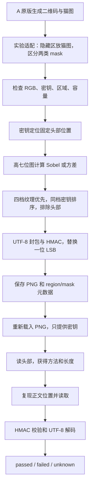
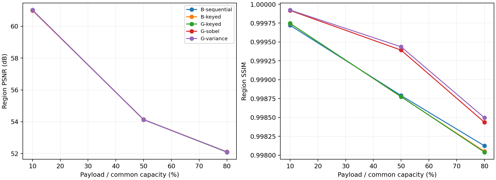

# G_交接说明

交付日期：2026-11-16。负责人：任务 G（ruoai）。

本次只新增文件：G 的算法、PNG 封装、测试、实验复现材料及报告。没有修改现有服务、前端、其他组员文件或原 requirements.txt，也没有提交或 push。G 已完成模块级验证；现有 HTTP 服务仍运行旧 CAT1 基线，不能把本次交付等同于网站已接入 G。

## 1. 交付概览与主要结论

- 完成密钥位置排序、Sobel 和局部方差自适应一位 LSB，嵌入和提取使用同一稳定高位特征，PNG 保存后可恢复。
- 与 B 的正式顺序/密钥置乱实现作对照，接入 C 正式检测器，复用 F 攻击算子。A 的区域保护冲突通过独立实验适配器解决，未改 A 原代码。
- 原研究运行使用 30 个真实猫图来源、五方法、三档载荷：450/450 个无攻击条件的恢复/扫码/保护检查通过，90/90 次 G 位置同步通过，另有 315 条攻击和 510 条纯算法计时记录。
- 50% 载荷下，Sobel 相对 B-keyed 的区域 SSIM 均值差为 +0.000619，配对 95% bootstrap 区间 [+0.000520,+0.000716]；PSNR 差的区间包含 0，不能确认改善。
- 代价是耗时增加，净容量比 B 少 4 字节。C 原阈值在真实猫图上误报率为 55%；检测结果不能证明安全，JPEG/裁剪等仍会破坏秘密。

本文统一说明交付接口、算法原理、实验设计、结果和接入事项。原始 CSV、图表、固定成员提交和照片许可均随新增文件交付，不依赖私人目录。

## 2. 文件清单与归属

| 新文件/目录 | 作用 | 是否用于正式运行 |
| --- | --- | --- |
| core/adaptive_steganography.py | G 位置、特征、容量、嵌入和提取 | 是，G 主模块 |
| core/g_png.py | PNG 自描述参数、保存和提取 | 是，G 文件传输模块 |
| requirements-g.txt | G 额外依赖；不修改公共依赖文件 | 安装时使用 |
| examples/g_demo.py | 真实猫图一键演示 | 验收示例 |
| tests/test_g_*.py | 核心、格式、传输、团队对齐、研究设计测试 | 回归测试 |
| experiments/g_summarize.py | 从 CSV 重建统计表和图表 | 实验工具 |
| experiments/g_compare.py | 五方法/三载荷及 F 攻击复现 | 实验工具 |
| experiments/g_team_adapter.py | A 掩码适配、B/C/F 调用与明确分流 | 实验用接入示例 |
| experiments/g_metrics.py | PSNR、SSIM 等本地指标；不冒充 E 正式模块 | 实验工具 |
| experiments/g_reference/ | A/B/C/F 固定提交快照和 SHA256 | 仅实验引用，作者归各组员 |
| experiments/data/g_cats/ | 30 张标准化 RGB PNG、来源及许可 | 实验数据 |
| experiments/results/g/ | 原始记录、图表、样例及来源核验 | 实测证据 |
| experiments/g_verify.py | 检查证据哈希及计数 | 快速核验 |
| experiments/requirements-g-research.txt | 已使用的研究依赖版本 | 完整实验环境 |

A/B/C 尚未合并到当前 main。为保证组长在此分支也能复现，实验引用固定快照，且校验原文件哈希。它们不会覆盖公共模块，也不是 G 本人开发的成果。正式集成应采用组长确认的各成员模块版本。

## 3. 安装、运行与复现

推荐在独立虚拟环境安装，避免改动正在使用的项目环境。只使用核心 G 时可在已有项目环境安装 `requirements-g.txt`；若运行完整测试和实验，使用研究版本集合：

```powershell
python -m pip install -r experiments/requirements-g-research.txt
python -B -m unittest discover -s tests -v
python -B -m examples.g_demo
python -B -m experiments.g_verify
```

这里的研究环境是 Python 3.10.8 / Pillow 12.0.0 / numpy 2.2.6 等；现有项目 requirements.txt 指定 Pillow 13.0.0，本次未改它。核心依赖声明允许 Pillow 12–13，但本轮验证实际运行在 12.0.0，不把版本范围声明当作每个版本均已实测。

演示输出 `outputs/g_demo/stego.png` 和 verification.json，使用公开固定测试密钥，非真实秘密。该 PNG 使用 GEX1；当前网页提取入口仍只处理 CAT1，因此请先用模块接口验证。

```powershell
# 两个来源的迁移烟雾测试；不替代完整实验
python -B -m experiments.g_compare --smoke
# 完整复现，默认写 outputs/g_compare，不覆盖已交付证据
python -B -m experiments.g_compare
python -B -m experiments.g_summarize
```

烟雾测试输出 outputs/g_smoke；完整实验耗时更长。重跑后的计时可能因机器负载改变。提交的 450 条原始记录是之前完整运行的原样迁移，不声称本次文件迁移重新跑了全部 450 条。核心算法与 PNG 封装按原字节迁移，provenance.json 可验证。

## 4. 核心接口及最小调用

```python
from core.adaptive_steganography import embed, extract, capacity_bytes
from core.g_png import save_png, extract_png

# image 为 RGB，region=(x,y,width,height)，mask=True 表示禁止改动。
# image、region、mask 由组长认可的 A 载体适配层提供。
result = embed(image, secret, key, region,
               protected_mask=mask, method='sobel')
save_png('stego.png', result, mask)
restored = extract_png('stego.png', key)
# restored: {'status': 'passed'/'failed'/'unknown', 'secret': str|None, 'detail': ...}
```

- 前四个参数与团队 B/G 约定一致；附加参数为 keyword-only。method 支持 keyed、sobel、variance，也保留 sequential 消融模式。默认 keyed，使用自适应请显式指定 sobel/variance。
- G 密钥必须是非空字符串。消息以 UTF-8 字节计容量；格式、容量或 mask 不合法时抛 ValueError。
- embed 返回 image、capacity_bytes、metadata 字典，不能直接把整个字典当 Pillow 图像或 JSON 图片输出。
- 底层 extract 需要 region/mask；extract_png 从 PNG 自带参数读取。提取不需要原图，也不需要外部提供方法 ID。
- 核心允许自定义区域和保护洞；本次 B/G 比较使用统一固定区域，内部没有额外保护洞，保证 B 也可使用相同位置范围。

## 5. 算法原理与提取同步

### 5.1 一位 LSB 写入

一个通道值为 0–255。写入比特 b 时执行 `I'=(I & 254)|b`。只改变最低位，单通道差值最多 1。例如 150 的二进制是 10010110，写 1 得 151，写 0 保持 150。一个 RGB 像素最多携带 3 bit。本实现用 UTF-8 编码，容量按字节算，不能把“中文字数”直接当字节数。

仅修改幅值很小不代表无法检测，也不保证对 JPEG、缩放、旋转稳健。PNG 无损保存能保持像素；隐写不是图像加密。

### 5.2 密钥如何确定位置

按 y→x→通道枚举 region 内 mask=False 的候选位置 `(x,y,c)`。上下文包含图像宽高、region 四个整数和完整 mask 的 SHA256。用 `HMAC-SHA256(key, domain || context || position)` 生成每个位置的排序键，按摘要排序；摘要相同再按 y/x/c 确定顺序。

头部 domain 与正文 domain 不同，避免二者使用同一种排序用途。先取头部的 352 个通道位置，再从正文候选集中排除这些位置；因此头部和正文不会覆盖。G-keyed 按正文排序键排列余下位置。相同图片尺寸、region、mask、密钥和版本会得到相同序列。不同密钥通常得到不同序列，但本项目没有证明隐写安全性，也没有把密钥排序等同于加密。

### 5.3 Sobel 与局部方差

首先对 RGB 全图清除最低位：`Q=I & 254`。整数灰度 `Y=(77R+150G+29B)>>8`；图像边界采用边缘像素复制，避免浮点差异及边界遗漏。

Sobel 用标准 3×3 水平、垂直梯度，纹理分数取 `abs(Gx)+abs(Gy)`。局部方差用 3×3 邻域计算整数分数 `9*sum(Y²)-sum(Y)²`，相当于方差乘固定常数，保持排序关系。分数高表示边缘或局部变化较强。

将可用像素按分数从高到低排序，相同分数按 y/x 排序，然后按排名分成四档；正文先用最高档，同档内用密钥排序。四档是本实现的固定设计，并未声称搜索到了最优分档。因为是四档策略，不能说每一个写入位置都严格按 Sobel 值递减。平坦图仍会按固定坐标/密钥规则分档，没有纹理优势。

### 5.4 为什么嵌入后还能同步

关键等式：`I' & 254 = I & 254`。无论最低位写成 0 还是 1，两边用于特征计算的高七位图都完全相同。因此灰度、梯度/方差、纹理分档都相同；再加上相同的密钥和上下文，正文位置相同。

头部位置完全不依赖纹理和方法。提取端先按密钥读固定头部，从中得到算法 ID 和消息长度，再计算对应正文位置并读取。这解决了“尚不知道算法，怎么先定位算法头”的循环依赖。实现既检查整个位置列表的相等性，也检查写入前后高七位完全不变。

证明成立的前提是像素高七位、尺寸、region、mask 不变；JPEG 和几何变换可破坏前提，不能把无损同步说成抗攻击同步。

### 5.5 GEX1 封包和容量

| 字段 | 字节数 | 含义 |
| --- | --- | --- |
| magic | 4 | ASCII GEX1 |
| method | 1 | sequential=0、keyed=1、sobel=2、variance=3 |
| version | 1 | 当前 1 |
| reserved | 2 | 必须为 0 |
| length | 4 | 大端 UTF-8 消息字节数 |
| tag | 32 | HMAC-SHA256，覆盖前 12 字节头、上下文和消息 |
| payload | 可变 | UTF-8 秘密内容 |

G 头部共 44 字节。可用像素数为 P 时，净容量为 `floor(3P/8)-44`。主实验 P=160×200=32000：总位数 96000，总字节数 12000，G 净容量 11956，B 为 11960。纹理策略只改变顺序，不主动丢弃低分位置，因此 G 三种主方法容量相同。若以后采用“只允许边缘像素”的策略，容量会下降，那是另一个版本。

### 5.6 PNG 元数据与校验范围

`core/g_png.py` 在 PNG 文本字段 `ruoai_gex1` 中记录版本、宽高、region、mask 摘要和压缩 mask。mask 使用按行 0/1 字节 → zlib → Base64；加载时限制像素数、解压长度，核对尺寸、编码和摘要。秘密和密钥不放在该文本字段中。元数据不是保密的；消息和关键上下文最终通过像素内 HMAC 验证。

导出的 G PNG 只需图像文件和密钥即可恢复，不需要原图、上次进程的变量或 CSV。图像工具若删除 PNG 文本字段，像素可能不变，但通用读取入口失去 region/mask，必须报错，不能假装参数仍然存在。受控调用者若另外提供完全相同的 region/mask 仍可调用底层 extract。裁剪后的尺寸不匹配会返回 unknown。

消息 HMAC 覆盖消息、头部、尺寸、region、mask；不覆盖整张图片的每一个 RGB 值。改动覆盖外像素，消息可能仍能通过。因此答辩不能说“passed 证明整张图没被改过”。B-sequential 使用空密钥，没有秘密密钥认证保证。G 也没有加密、口令强化或随机 nonce；重复输入是确定性的研究实现。

### 5.7 嵌入与提取流程图



## 6. 团队接入事项与职责边界

**A 的掩码语义。** 原版 A 把整个秘密区标记 True，并保持该区域纯白。直接遵守这个 mask 就没有可写位置。实验适配器保留原 mask 为 fusion_protected_mask，在声明的 160×200 矩形内放置猫图，并另设隐写 mask；矩形外像素保持原样。这个载体明确标记 A-G-private-1，名称为既有实验版本，不表示依赖私人目录。组长需确认是否将两类保护语义纳入 A 的正式输出，不应默默忽略原 mask。

**B/G 的版本分流。** B 是 CAT1、40 字节头、净容量 11960；G 是 GEX1、44 字节头、净容量 11956。GEX1 是独立实验格式，尚未占用团队预留的 CAT2。当前 CAT1 图继续按 B 解析，G 图需明确选择 G 入口，不能直接替换 service.embed/extract 使历史图失效。PNG 文本键 ruoai_gex1 和内部 HMAC domain 保留是为了兼容既有 G 图片，并不是文件路径依赖。

**PNG 参数传输。** 服务生成 G 图片应调用 g_png.save_png 保存到 BytesIO 再转 Base64；普通 image.save 会丢失需要的 region/mask 参数。提取应保留原 PNG 字节并传入 g_png.extract_png；只 convert('RGB') 后重新编码可能丢失参数。缺失或损坏参数应作为明确输入错误处理，不能转换为 passed。统计检测、消息认证和整图认证仍是不同状态。

本轮没有更改 service.py、app.py 或前端，也没有自动合并其他分支。完成上述协议确认后，再由组长安排服务路由、算法选项和历史格式回归。

### 6.1 与 C/D/E/F 的边界

| 成员 | 本次用法 | 集成注意 |
| --- | --- | --- |
| C | 正式 bias-adjusted chi-square、原校准 0.5；另做独立集共同阈值分析 | 固定 region/校准版本；score 不是含密概率 |
| D | 使用 G 消息 HMAC；没有另造正式 D 模块 | passed 不代表整图不变，也不能定位篡改 |
| E | 本地 PSNR 与 RGB 7×7 SSIM，记录全图和隐藏区 | 以后 E 交付需核对窗口、动态范围、计时定义 |
| F | 原样 apply_attack/decode_qr；由 G 批处理传入对应算法上下文 | 容量用实际值；扫码/恢复/消息认证分别统计 |

## 7. 实验来源、设计与验证口径

本报告的 450 条对比、315 条攻击和 510 条计时来自先前已完成的完整实测，本次按原始字节迁移到 experiments/results/g，不声称迁移过程重新运行了完整实验。G 核心和 PNG 封装与实测版本字节相同；来源、文件哈希和原始结果由 provenance.json 记录。正式目录另外执行回归和两来源烟雾测试，验证迁移未改变结果，见 formal_validation.json。

A/B/C/F 快照属于各成员的贡献。快照提交、路径和哈希见 experiments/g_reference/manifest.json，内容未修改。B 的顺序和密钥置乱两种配置直接用正式 B 实现；C 使用正式偏差修正卡方检测器；F 复用正式攻击和扫码算子。E/D 尚无此分支的新正式实现，质量指标由本地实验辅助模块计算，消息认证不冒充整图认证。

使用已留存的 30 张 Commons 猫照片，每个来源/作者只选一张；10 张校准、20 张评估，来源和作者不交叉，脚本检查每张 RGB 哈希。照片不是随机抽样的大规模自然图像基准，衍生的许多含密图不能当成许多独立来源。完整许可和加工说明在数据目录的 ATTRIBUTION.md、manifest.json；使用原图及衍生图仍需保留各自作者和许可。

固定 A 的 H 纠错、公开文本、隐藏区 160×200。五方法同一载体、同一消息字节数；载荷按共同容量 11956 的 10%、50%、80% 取整，为 1195、5978、9564 字节，而不是各方法分别按自己的容量取不同长度。消息是固定种子的可打印 ASCII，中文/emoji/空消息/满容量由单元测试补充；性能和检测结论不能直接推广到所有文本分布。

| 项目 | 实测 |
| --- | --- |
| 原研究阶段回归测试 | 27 项；失败 0，错误 0，跳过 0 |
| 来源划分 | 30 张；校准 10 / 评估 20 |
| 主实验条件 | 450 |
| PNG 秘密恢复 | 450/450 |
| 公开扫码 | 450/450；未测 0 |
| 保护区域像素检查 | 450/450 |
| G 完整位置序列检查 | 90/90 |
| 纯算法计时记录 | 510 |
| F 攻击记录 | 315 |
| 运行环境 | Python 3.10.8 / numpy 2.2.6 / Pillow 12.0.0 |

每个条件均保存 PNG 到字节流、重新打开，再恢复秘密；不是只测内存中原对象。每个条件验证区域外像素不变。G 三种方法在 50% 载荷下逐项核对完整位置序列。只有代表输出保存成磁盘 PNG，其余保留原始 CSV，避免几百张重复中间图。

纯算法计时不含 PNG、扫码、C 检测和质量指标；每个方法开始先预热一次，首六来源在 50% 载荷重复三次，其他条件一次；算法执行次序随来源轮换。时间表先对同来源重复取中位数，再对 20 个评估来源取中位数，不能与网络端到端耗时混为一谈。

## 8. 图像质量、容量和耗时

以下均为 20 张独立评估来源、50% 共同载荷。PSNR/SSIM 为原始无秘密载体与含密图配对计算。整幅图有大量不变二维码像素，可能掩盖猫图损伤，因此额外报告隐藏区域指标。SSIM 用 RGB、data_range=255、win_size=7；结果受窗口定义影响。

MSE 是所有参与计算的 RGB 通道平方差均值；`PSNR=10*log10(255²/MSE)`，单位 dB，MSE 为 0 时记 inf。SSIM 衡量局部亮度、对比度及结构相似性，本实现调用 scikit-image 的 structural_similarity。指标接近 1 不等于统计检测不可发现秘密。

| 方法 | 来源数 | 全图 PSNR/dB | 全图 SSIM | 区域 PSNR/dB | 区域 SSIM |
| --- | --- | --- | --- | --- | --- |
| B-sequential | 20 | 62.329 | 0.999812 | 54.140 | 0.998790 |
| B-keyed | 20 | 62.324 | 0.999812 | 54.135 | 0.998773 |
| G-keyed | 20 | 62.322 | 0.999813 | 54.133 | 0.998775 |
| G-sobel | 20 | 62.328 | 0.999906 | 54.139 | 0.999392 |
| G-variance | 20 | 62.320 | 0.999913 | 54.130 | 0.999436 |



容量和当前机器纯算法时间：

| 方法 | 净容量/字节 | 嵌入/ms | 提取/ms |
| --- | --- | --- | --- |
| B-sequential | 11960 | 34.1 | 26.5 |
| B-keyed | 11960 | 59.5 | 45.9 |
| G-keyed | 11956 | 379.7 | 550.1 |
| G-sobel | 11956 | 484.2 | 621.1 |
| G-variance | 11956 | 500.3 | 673.0 |

解释：一位 LSB 每次改变幅值相同，PSNR 主要取决于实际翻转通道数，不能预设选边缘一定提高 PSNR。Sobel 的目的在于把改变更多分配到纹理较强处，其收益需要从局部结构指标和检测结果实测。HMAC 为所有候选位置排序，加上纹理计算和排序，会比 B 的随机 shuffle 更慢；大致为 O(N log N) 时间、O(N) 位置存储。未做生产级优化。

为避免只看均值，把同一来源的 G 与 B 做配对差值，在 20 个来源上有放回重采样 10000 次，报告均值差的 percentile 95% bootstrap 区间。此为探索性区间，未作多重比较校正；不代表总体保证。

| 参照 | G 方法 | 指标 | 均值差 G−B | 95% 区间 |
| --- | --- | --- | --- | --- |
| B-sequential | G-keyed | region_psnr_db | -0.007252 | [-0.017310, +0.003323] |
| B-sequential | G-keyed | region_ssim | -0.000016 | [-0.000120, +0.000090] |
| B-sequential | G-sobel | region_psnr_db | -0.000796 | [-0.016223, +0.013318] |
| B-sequential | G-sobel | region_ssim | +0.000602 | [+0.000461, +0.000748] |
| B-sequential | G-variance | region_psnr_db | -0.009744 | [-0.023543, +0.004464] |
| B-sequential | G-variance | region_ssim | +0.000646 | [+0.000508, +0.000791] |
| B-keyed | G-keyed | region_psnr_db | -0.001847 | [-0.013134, +0.010027] |
| B-keyed | G-keyed | region_ssim | +0.000002 | [-0.000003, +0.000006] |
| B-keyed | G-sobel | region_psnr_db | +0.004608 | [-0.011049, +0.018587] |
| B-keyed | G-sobel | region_ssim | +0.000619 | [+0.000520, +0.000716] |
| B-keyed | G-variance | region_psnr_db | -0.004340 | [-0.019076, +0.009429] |
| B-keyed | G-variance | region_ssim | +0.000664 | [+0.000560, +0.000762] |

50% 共同载荷下，G-Sobel 相对 B-keyed 的隐藏区域 SSIM 平均差为 +0.000619，按来源配对 bootstrap 95% 区间为 [+0.000520, +0.000716]。该区间不包含 0，但仍仅代表本次小样本和固定参数。

## 9. C 检测结果与解释

C 汇总 RGB 偶数/相邻奇数计数，原统计量 `r=sum((even-odd)^2/(2*(even+odd)))`；设有效值对数 k、通道样本数 N、LSB 为 1 的比例 b，使用 `r_adj=max(0,r-2N(b-0.5)^2)`，再以自由度 k-1 的卡方生存函数得到分数。这个偏差修正用于减轻消息位分布偏离一半时的影响，不能保证所有自然纹理/短消息都能检出。平坦/样本不足等情况按 C 返回 inconclusive。

以下为每方法 20 正常图 + 20 张 50% 载荷含密图。正常图在不同方法中共享，不应把表内总行数当独立照片数。TP 真阳性、TN 真阴性、FP 误报、FN 漏报；平衡准确率=(召回率+特异度)/2。inconclusive 单独计数，不当正确或错误，比例仅在可判定样本上算。

官方阈值固定 0.5；本地共同阈值为 0.391946818876，只由校准集选出。

| 方法 | 阈值 | TP | TN | FP | FN | 不可判定 | 平衡准确率 | 误报率 |
| --- | --- | --- | --- | --- | --- | --- | --- | --- |
| B-sequential | C 原阈值 | 14 | 9 | 11 | 6 | 0 | 57.5% | 55.0% |
| B-sequential | 共同校准阈值 | 14 | 8 | 12 | 6 | 0 | 55.0% | 60.0% |
| B-keyed | C 原阈值 | 17 | 9 | 11 | 3 | 0 | 65.0% | 55.0% |
| B-keyed | 共同校准阈值 | 17 | 8 | 12 | 3 | 0 | 62.5% | 60.0% |
| G-keyed | C 原阈值 | 17 | 9 | 11 | 3 | 0 | 65.0% | 55.0% |
| G-keyed | 共同校准阈值 | 17 | 8 | 12 | 3 | 0 | 62.5% | 60.0% |
| G-sobel | C 原阈值 | 12 | 9 | 11 | 8 | 0 | 52.5% | 55.0% |
| G-sobel | 共同校准阈值 | 12 | 8 | 12 | 8 | 0 | 50.0% | 60.0% |
| G-variance | C 原阈值 | 10 | 9 | 11 | 10 | 0 | 47.5% | 55.0% |
| G-variance | 共同校准阈值 | 11 | 8 | 12 | 9 | 0 | 47.5% | 60.0% |

在 50% 载荷和 C 原阈值下，B-keyed 检出 17/20，G-Sobel 检出 12/20；但同一批正常图有 11/20 被误报，误报率 55.0%。共同校准阈值下正常图误报率为 60.0%。因此检测器在真实猫图上的误报问题不能忽略；这些结果仅支持本实验操作点的比较，不能作为安全性证明。

其他 10%/80% 载荷见 detection_results.json。不能挑选最有利的一行宣称全面胜出；低检出率只说明这个检测器在此数据和操作点漏检较多，不证明“无法检测”“绝对隐蔽”或“比其他算法安全”。共同校准阈值只对当前校准数据拟合，不能直接部署作通用阈值。

## 10. F 攻击结果与边界

强度使用 F 的 0–100 标度，s=强度/100；0 直接返回复制图像。JPEG 的 quality=round((1-0.95s)*100)，subsampling=0；高斯噪声标准差 40s；椒盐概率 0.3s；中心白块名义宽高为图像宽高的 0.5s；定点白块名义宽为 160s、高 200 像素；四边各裁去 0.2s 并取整，不补边；顺时针旋转 45s 度、双三次插值、不扩画布。矩形绘制包含终点，实际像素范围可能比名义宽高多 1，保持 F 原始实现。

例如强度 20 对应 JPEG quality=81、高斯标准差 8、椒盐概率 6%、每边裁剪 4%、旋转 9°。每个样本/载荷内五算法使用相同种子。扫码固定先灰度解码，失败再做 2 倍最近邻解码。

选前三个评估来源 cat02、cat03、cat05，五算法，50% 载荷；每种攻击/强度为 15 次，共 315 条记录。三张原图是独立来源，15 是五方法衍生条件数。强度 0 用作各攻击路径的无变化对照，不能把重复的零强度当额外独立成功证据。

| 攻击 | 强度 | 条件数 | 扫码成功 | 秘密恢复 | 认证通过 | 认证失败 | 未知 |
| --- | --- | --- | --- | --- | --- | --- | --- |
| jpeg | 0 | 15 | 15/15 | 15/15 | 15 | 0 | 0 |
| jpeg | 20 | 15 | 15/15 | 0/15 | 0 | 0 | 15 |
| jpeg | 60 | 15 | 15/15 | 0/15 | 0 | 0 | 15 |
| gaussian | 0 | 15 | 15/15 | 15/15 | 15 | 0 | 0 |
| gaussian | 20 | 15 | 15/15 | 0/15 | 0 | 0 | 15 |
| gaussian | 60 | 15 | 15/15 | 0/15 | 0 | 0 | 15 |
| salt | 0 | 15 | 15/15 | 15/15 | 15 | 0 | 0 |
| salt | 20 | 15 | 0/15 | 0/15 | 0 | 6 | 9 |
| salt | 60 | 15 | 0/15 | 0/15 | 0 | 1 | 14 |
| occlude | 0 | 15 | 15/15 | 15/15 | 15 | 0 | 0 |
| occlude | 20 | 15 | 15/15 | 15/15 | 15 | 0 | 0 |
| occlude | 60 | 15 | 0/15 | 15/15 | 15 | 0 | 0 |
| occlude_region | 0 | 15 | 15/15 | 15/15 | 15 | 0 | 0 |
| occlude_region | 20 | 15 | 15/15 | 0/15 | 0 | 0 | 15 |
| occlude_region | 60 | 15 | 15/15 | 0/15 | 0 | 0 | 15 |
| crop | 0 | 15 | 15/15 | 15/15 | 15 | 0 | 0 |
| crop | 20 | 15 | 15/15 | 0/15 | 0 | 0 | 15 |
| crop | 60 | 15 | 0/15 | 0/15 | 0 | 0 | 15 |
| rotate | 0 | 15 | 15/15 | 15/15 | 15 | 0 | 0 |
| rotate | 20 | 15 | 15/15 | 0/15 | 0 | 0 | 15 |
| rotate | 60 | 15 | 0/15 | 0/15 | 0 | 0 | 15 |

表中认证通过/失败/未知只描述消息提取状态，不是整图认证。二维码与秘密的成功率分别统计。二维码有自己的编码纠错；像素 LSB 没有相应纠错机制，所以扫码成功并不意味着秘密还在。F 的 crop 实际缩小尺寸，本版本没有几何同步恢复，会返回 unknown；JPEG/噪声会改最低位；旋转会改采样位置。不能说 Sobel 改进了抗压缩性。

攻击后 PSNR/SSIM 在 robustness.csv 中是“攻击前含密图 vs 攻击后图”，含义与主实验的“原始图 vs 含密图”不同；尺寸不一致留空，不伪造为 0。攻击后的 C 分数未测，字段留空。

## 11. 正式目录迁移验证

正式目录执行 29 项测试（含原有 CAT1 的 2 项）全部通过；两来源烟雾验证为 30 个对比条件、105 条攻击。除运行耗时外，对比字段与历史完整实验对应行完全相同，攻击记录全部字段一致。已有 78 个受 Git 跟踪文件的 SHA256 核对无变化。

迁移后的正式目录测试、烟雾测试与历史记录一致性检查见
[formal_validation.json](../experiments/results/g/formal_validation.json)；测试日志见
[formal_tests.txt](../experiments/results/g/formal_tests.txt)。这些记录与原研究阶段 27 项测试分开保存。

## 12. 原始数据与审阅索引

| 文件 | 内容 |
| --- | --- |
| experiments/results/g/comparison.csv | 450 条五方法/三载荷记录，含扫码、恢复、图像质量、检测与保护 |
| experiments/results/g/detection_samples.csv | 30 张正常图 + 450 张含密图的 C 分数 |
| experiments/results/g/detection_results.json | 官方阈值/共同校准阈值的分载荷混淆矩阵 |
| experiments/results/g/timings.csv | 510 条纯算法计时记录 |
| experiments/results/g/robustness.csv | 315 条 F 攻击记录 |
| experiments/results/g/aggregates.json | 评估均值、配对差值与 bootstrap 区间 |
| experiments/results/g/summary.json | 样本数、环境、来源哈希、实验口径 |
| experiments/results/g/provenance.json | 迁移来源说明及实测核心/证据文件哈希 |
| experiments/results/g/formal_validation.json | 新增正式文件的迁移验证；与历史完整实测区分 |
| experiments/data/g_cats/ATTRIBUTION.md | 照片作者、许可及来源 |
| experiments/g_reference/manifest.json | A/B/C/F 冻结提交与哈希 |

结论仅覆盖当前数据、载体、位置协议和参数。下一步公共服务接入须保留 CAT1 路径，明确 G 的 PNG 参数传输，并由组长确认 A 的掩码契约。本次仅新增正式交付文件。

## 13. 答辩汇报内容

**目标：** 在 B 基线之上研究纹理优先的一位 LSB，并保证提取位置复现。

**三步原理：** 清除最低位得到稳定高七位图 → Sobel/方差分为四档，同档密钥排序 → 独立头部给出方法 ID，再按相同顺序恢复正文。

**核心等式：** I'=(I & 254)|b，因此 I' & 254=I & 254。

**结果：** 30 来源、450 条件全部无损恢复与扫码；50% 载荷时 Sobel 相对 B-keyed 区域 SSIM +0.000619，95% 区间 [+0.000520,+0.000716]。图使用 experiments/results/g/quality_comparison.png，注明评估来源数 20。

**结论与限制：** 本样本中局部结构指标改善；PSNR 没有明确改善，运行更慢，容量少 4 字节；不能抗 JPEG/几何变换，不能据低检出率证明安全。
